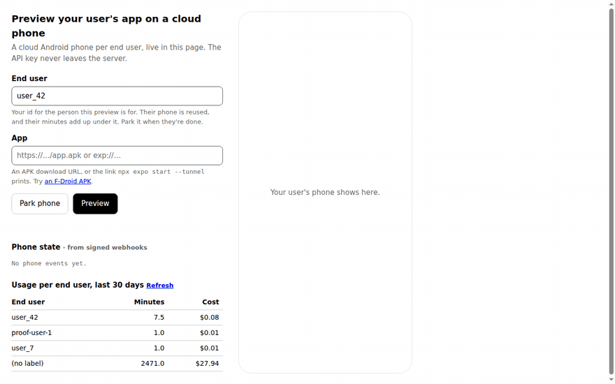

# App-builder preview

Show each of your users their app on a cloud Android phone, live in your own page. The whole integration is two files and no dependencies: `server.mjs` (about 150 lines) and `index.html`.



What it does:

1. **Keeps your API key on the server.** The browser only ever gets a short-lived embed URL.
2. **One phone per end user.** It creates the phone with `end_user` (your id for the person) and `display_hz: 30` for smooth scrolling, reuses it next time and starts it again if it's parked.
3. **Loads the app.** An APK URL installs and opens. An Expo link (`exp://`, `exps://`, `https://expo.dev/…`) opens in Expo Go, and Mobilebox installs the Expo Go that matches the project's SDK.
4. **Embeds the live phone** through `/embed`, locked to your page's origin. Your user can tap, swipe and type on it.
5. **Receives signed webhooks** (`phone.ready`, `phone.parked`, `phone.deleted`, `phone.failed`), checks the signature and shows each phone's state.
6. **Shows usage per end user**, the minutes and cost you can bill them for.

## Run it in 10 minutes

You need Node 20 or newer, a Mobilebox API key ([sign up](https://mobilebox.dev/signup)), and a public URL for this server so Mobilebox can send it webhooks. A Cloudflare quick tunnel works without an account:

```bash
git clone https://github.com/mobilebox-dev/mobilebox && cd mobilebox/examples/app-builder-preview
cloudflared tunnel --url http://localhost:3000        # prints https://….trycloudflare.com; leave it running
```

In a second terminal:

```bash
export MOBILESANDBOX_API_KEY=…                       # from https://mobilebox.dev/dashboard
export PUBLIC_URL=https://….trycloudflare.com        # the URL the tunnel printed
node server.mjs
```

Open `PUBLIC_URL` in your browser. Pick an end user id, paste an APK URL (or press **an F-Droid APK**), and press **Preview**. A fresh phone takes about 30 s to boot and install; a parked one comes back in about 15 s.

For an Expo project, run `npx expo start --tunnel` and paste the `exp://` link it prints.

On start the server:

- adds your page's origin to the workspace's embed origins (`PUT /v1/embed/origins`, keeping the ones you have);
- points the workspace's webhook at `PUBLIC_URL/webhooks/mobilebox`.

A workspace has one webhook URL, so if yours already points somewhere else the server leaves it alone and says so. Use a separate workspace for this example, or set `MOBILEBOX_TAKE_WEBHOOK=1`.

## How it works

| Step | Code | Mobilebox API |
|---|---|---|
| A phone per end user | `phoneFor()` | `GET /v1/phones?end_user=…`, `POST /v1/phones {end_user, display_hz: 30}`, `POST /v1/phones/{id}/start` |
| The app on it | `load()` | `POST /v1/phones/{id}/apps {url}` + `open_app`, or `open_url` for Expo |
| The live phone in your page | `/api/preview` | `POST /v1/phones/{id}/embed {origin, interactive: true, ttl: 900}` |
| Phone state | `verify()`, `onWebhook()` | `PUT /v1/webhooks {url}`; events signed `Mobilebox-Signature: t=…,v1=…` |
| Usage per end user | `/api/usage` | `GET /v1/account/usage?by=end_user` |
| Done | `/api/park` | `DELETE /v1/phones/{id}/embed`, `POST /v1/phones/{id}/park` |

`node server.mjs --self-check` tests the signature check without a key.

## Before you ship it

- **Store state in your database.** This example keeps webhook events in memory. Keep the phone id and its last state per end user, and drop repeats by the event `id` (a retry sends the same one).
- **Answer webhooks fast.** Return 2xx within 10 s and do the work after. We retry after 10 s, 1 min, 10 min and 1 h.
- **Keep embed links short-lived.** Make a new link when one ends (the iframe tells your page with `mobilebox:end`). Revoke the link when your user leaves.
- **Park idle phones.** A parked phone keeps its apps and data and costs nothing. Phones also park by themselves after their idle timeout.
- **Plan for more users.** A workspace runs 3 phones at once to start. `POST /v1/account/limits {"running": n}` asks for more, and we answer within a day.

The page polls `/api/events` every 2 s instead of holding a server-sent event stream, because tunnels and proxies, Cloudflare's quick tunnels among them, often hold such a stream back.

Reference: [embed](https://mobilebox.dev/docs/embed), [Expo](https://mobilebox.dev/docs/expo), [labels, usage, webhooks and limits](https://mobilebox.dev/docs/reference#one-phone-per-end-user-labels-usage-webhooks-limits).

## Recorded run

**2026-11-25**, Node 24 on Linux, against production through a Cloudflare quick tunnel, Chrome:

| Step | Result | Time |
|---|---|---|
| Preview, `user_42`, F-Droid Editor 1.98 APK, new phone | installed, live in the page at 30 Hz, a click in the page reached the phone | 29 s |
| Park phone | `phone.parked` (manual) arrived signed; usage: user_42 2.2 min, $0.02 | 2 s |
| Preview again, `user_42` | parked phone started, `phone.ready`, app reinstalled, live | 15 s |
| Preview, `user_7`, Expo SDK 58 project (`exps://…exp.direct`), new phone | Expo Go 58.0.6 installed itself, app live; an edit showed by Fast Refresh in the embed | 30 s |
| Park phone, `user_7` | `phone.parked` arrived, the embed showed "This preview was closed", usage: user_7 1 min, $0.01 | 2 s |

An unsigned POST to the webhook URL got 401. Expo Go shows its developer menu once on a new phone; your user closes it in the embed.
